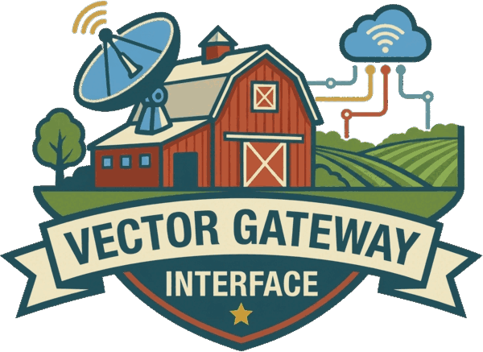

# Trajectory notebooks

<a href="https://query.farm/"></a>

<a href="https://query.farm/vgi/"></a>

[Query.Farm](https://query.farm/) · [VGI](https://query.farm/vgi/) · [Haybarn](https://query.farm/products/haybarn/)

| Notebook | Investigation |
|---|---|
| [01 · A visit with no fixes inside](01_visits_between_fixes.ipynb) | Compare sampled geofence membership with inferred entry, exit, dwell and trips; lower the interpolation gap limit to expose unknown movement. |

This independently executable Python notebook uses a native Haybarn connection,
JupySQL `%%sql`, the real VGI extension and the published Python worker at a full Git revision. SQL
performs retrieval, spatial membership checks, reconstruction and aggregation.
Python supplies presentation. Successful outputs, including three PNG charts,
are saved in the notebook.

## Install and select a kernel

From a standalone copy of this notebooks directory, with [uv](https://docs.astral.sh/uv/) installed:

```sh
uv sync --locked
```

The visible literal ATTACH uses uvx to install the worker from public Git revision
`79d882f829fe45d0ef9a5ac2d7ad5b85c773f4f2`. It requires Python 3.13 or newer and preserves the
worker's SDK compatibility range. The separate notebook environment supports
Python 3.13–3.14 and pins Haybarn 2.0.0rc11. No source checkout or root virtual
environment is needed. First dependency and extension installation needs network
access; the actual analysis uses local synthetic inputs with no replay/live switch.

Choose `.venv/bin/python` in your notebook editor, then restart and run all.
Alternatively register that kernel explicitly:

```sh
uv run python -m ipykernel install --user --name vgi-trajectory-notebooks --display-name "VGI Trajectory notebooks"
```

The runner creates its own temporary kernel specification without registration.
To upgrade the worker, change the visible full revision, verify that
fixtures/fences.json still matches that revision's bundled fence, and rerun the
default, focused experiment and invariants; compatibility must be verified through Haybarn.

The visible parameters cell controls `MAX_GAP_S`, the largest interval between
fixes that the worker will interpolate. It accepts finite positive seconds.
Edit it and **Restart Kernel → Run All**. The default is **900.0**; the end
experiment uses **60.0**. The worker rejects intervals strictly greater than the
limit, so an interval equal to the limit remains eligible.

Imports, styling, plotting source, generated prose source and cleanup have both
Jupyter folding metadata and descriptive tags. Connection SQL, analytical SQL,
tables, interpretations and charts remain visible. Some editors retain folding
in their own state: if Python inputs expand, use **Collapse Cell Input**
on the tagged setup/plotting cells while leaving their useful outputs expanded.

## Execute and save

From this notebooks directory:

```sh
uv run python execute.py
```

The runner creates a temporary kernel specification with this interpreter,
starts a fresh kernel, rejects cell errors and saves the notebook only after a
successful run. It does not install a global kernel. A failed run leaves the
previous successful example unchanged.

Verify the one-parameter experiment in a separate copy:

```sh
uv run python execute.py \
  --parameters '{"MAX_GAP_S": 60.0}' \
  --output-dir artifacts/gap-60
```

The runner rejects unknown parameters, overrides without a separate output
directory, and destinations that would overwrite the source. It writes atomically
only after complete success. Experiment copies contain branding, the fence fixture,
helpers, locked environment files and this guide, so they can run independently.
The focused experiment is also validated from a separate copy containing only the
notebook directory. Generated files under `artifacts/` and older `validation/`
are ignored. A failed run preserves the last successful saved default.

The Haybarn connection starts with an empty temporary secret directory and
persistent secrets disabled. It verifies an empty inventory before ATTACH and
again before closing the connection and deleting that temporary directory. The
synthetic computation needs no credential and creates no SQL secrets.

The notebook checks timestamp durations, single-fence time accounting,
independently computed spatial path lengths, and NULL geometry/distance for gaps.
They check internal consistency, not the truth of unobserved vehicle movements.
The source passed `make release-check`: 23 pytest tests; 146 stdio, 146 Unix-launch
and 107 HTTP SQL assertions; six stock DuckDB contracts and six isolated sdist-built
wheel contracts; Ruff, strict mypy and pydoclint; metadata 100/100 L2 with zero findings.
Domain code, the current external metadata/example commit and root dependency lock
were preserved. No container image publication or deployment was performed.
Notebook lint uses `uvx ruff check .` and `uvx ruff format --check .`.

## Inputs, units and model limits

- `trajectory.main.demo_input` supplies four synthetic fixes from the worker:
  one crossing track and one stationary track, both starting at
  **2026-01-01 00:00:00 UTC**. Their last fixes occur at 00:02:00 and 00:10:00 UTC.
- [`fixtures/fences.json`](fixtures/fences.json)
  is an unchanged copy of the published worker fixture and supplies the same yard polygon used by `demo://fences.json`. This fixture
  deliberately contains projected coordinates, unlike ordinary geographic
  GeoJSON. Input, fence and analysis CRS are explicitly **EPSG:32618**,
  WGS 84 / UTM zone 18N, X/Y order, metres. Map axes subtract a clearly labeled
  origin for legibility; no coordinate transformation is hidden.
- “Van 7” and “Van 9” are illustrative SQL labels joined by `entity_id`.
- The worker interpolates straight segments at constant progress. It does not
  map-match roads or establish the true unobserved route. Speed remains limited
  to 80 m/s, supplied accuracy to 100 m, minimum dwell to 0 s and fence buffer
  to 0 m. The bundled fixes do not supply accuracy measurements.
- All source timestamps are included. Durations are elapsed seconds between
  episode endpoints. Fix counts include both endpoints; a boundary fix may
  belong to adjacent episodes. Never sum those counts as unique observations.
- Censored endpoints indicate incomplete observation of the start/end of a
  visit. A stationary model does not prove the vehicle stayed there throughout.
  Gaps retain unavailable distance, distinct from a stationary path's zero.
- The time-partition invariant applies to this single fence with no dwell
  filtering. Overlapping fences or filtering short visits change that accounting.

The default run reconstructs a **60 s** yard visit with **zero recorded fixes
inside**, between 00:00:30 and 00:01:30 UTC, plus two 30 s trips. The stationary
track produces a **600 s** modeled visit with both endpoints censored. At a
60 s maximum gap, both tracks become `long_gap`: **720 entity-seconds** of unknown
movement and NULL distances. The stricter result reflects a changed inference
rule, not newly observed movement.

`notebook_support.py` only handles formatting, parameter validation and chart presentation. Analytical SQL remains visible in the notebook.
Ordinary in-memory tables are intentional because JupySQL uses separate cursors;
temporary tables may be cursor-local. The final cleanup closes the connection.

The two branding assets are copied unchanged from `vgi-perps/notebooks/assets/`.
The Strata Sun + Query.Farm wordmark originates from the official adaptive
`logo/wordmark-adaptive.svg`; the VGI logo originates from
`products/vgi/vgi-logo.png` in the Query.Farm media kit. Both are local assets.

---

<a href="https://query.farm/"></a>
